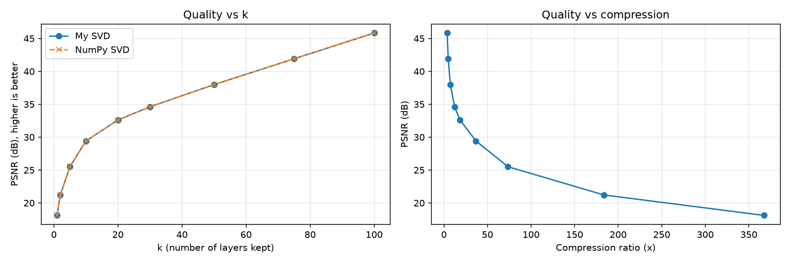

# SVD Image Compression from Scratch

Compressing a grayscale image using Singular Value Decomposition (SVD),
with the SVD algorithm implemented from scratch in NumPy (power iteration
with deflation) rather than a library call.

**Author:** pakeezaafzaal, BS Mathematics student

## Method
- An image is a matrix A. SVD writes A as a sum of rank-1 layers ordered by importance.
- Keeping only the top k layers gives the best rank-k approximation (Eckart-Young theorem).
- I implemented SVD myself using power iteration and deflation, and validated it
  against `numpy.linalg.svd`.
- Storage for rank k: k(m + n + 1) numbers instead of m*n.

## Mathematical background

A grayscale image is a matrix $A \in \mathbb{R}^{m \times n}$ with SVD

$$A = \sum_{i=1}^{r} \sigma_i u_i v_i^T, \qquad \sigma_1 \ge \dots \ge \sigma_r > 0.$$

**Eckart-Young theorem.** The truncation $A_k = \sum_{i=1}^{k} \sigma_i u_i v_i^T$ is the best rank-k approximation of $A$, with

```math
\lVert A - A_k \rVert_2 = \sigma_{k+1}, \qquad \lVert A - A_k \rVert_F = \sqrt{\sum_{i>k} \sigma_i^2}
```

**Storage.** $A_k$ needs $k(m+n+1)$ numbers instead of $mn$.

**Quality.** $\mathrm{PSNR} = 10 \log_{10}\dfrac{M^2}{\mathrm{MSE}}$, where $M$ is the maximum pixel value.

## Results (736x736 image)
| k | PSNR (dB) | Compression ratio |
|---|-----------|-------------------|
| 5 | 25.50 | 73.6x |
| 10 | 29.42 | 36.8x |
| 20 | 32.62 | 18.4x |
| 50 | 37.98 | 7.4x |
| 100 | 45.83 | 3.7x |



My implementation matches NumPy's singular values and reconstruction quality exactly.

## What I learned
- How SVD splits a matrix into layers of decreasing importance
- The trade-off between compression ratio and image quality
- How to implement and validate a numerical algorithm from scratch

## Limitations / future work
- Power iteration is slower than library SVD for large matrices
- Next: randomized SVD, and color images (apply SVD to each channel)

## Run it
`pip install numpy matplotlib`, then open the notebook and update the image path.
